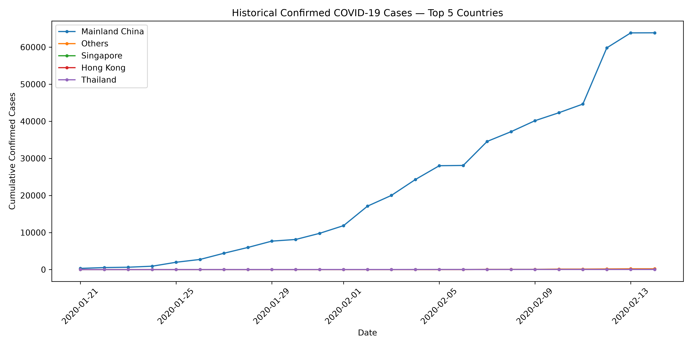
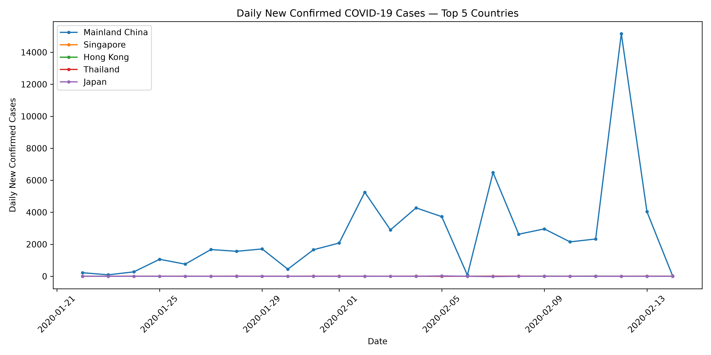

# COVID-19 Pandemic Analysis

## Project Overview

This project analyzes COVID-19 data using Python and Pandas. It processes daily reports, aggregates cases by country, calculates daily changes, and adds geographical information for analysis.

The project also includes historical COVID-19 time-series analysis and visualizations to explore the spread of the pandemic across countries and continents.

## Objectives

- Analyze confirmed cases, deaths, and recoveries.
- Aggregate COVID-19 data at country level.
- Calculate daily changes in confirmed cases.
- Calculate cases since the first available date.
- Map countries to continents.
- Calculate mortality and recovery rates.
- Extract geographical coordinates.
- Analyze historical COVID-19 confirmed cases.
- Create visualizations to communicate trends and comparisons.

## Technologies Used

- Python
- Pandas
- Matplotlib
- NumPy
- Git and GitHub

## Project Workflow

The project processes raw COVID-19 daily reports and generates multiple processed datasets for further analysis.

## Data Processing

1. Load raw COVID-19 daily reports.
2. Aggregate confirmed cases, deaths, and recoveries by country.
3. Calculate daily changes in confirmed cases.
4. Calculate cases since the first available date.
5. Create a country-to-continent mapping.
6. Add continent information to COVID-19 records.
7. Extract geographical coordinates.
8. Calculate country-level statistics and mortality/recovery rates.
9. Save processed datasets in `data/processed/`.
10. Download and process historical COVID-19 time-series data.
11. Generate charts for country-level, continent-level, and historical trend analysis.

## Generated Datasets

The project generates the following processed datasets:

- `country_cases.csv`
- `country_daily_change.csv`
- `country_cases_since_t0.csv`
- `country_to_continent.csv`
- `covid_with_continents.csv`
- `country_coordinates.csv`
- `country_stats.csv`
- `country_mortality.csv`
- `unmatched_countries.csv`

Historical analysis dataset:

- `time_series_confirmed.csv`
- `country_historical_daily.csv`

## Visualizations

The project contains 11 visualization charts generated using Matplotlib.

## Sample Visualizations

### Historical COVID-19 Cases



### Daily New Confirmed Cases




### Country-Level Analysis

- `top_10_country_cases.png` — Top 10 countries by confirmed cases.
- `top_10_country_deaths.png` — Top 10 countries by deaths.
- `top_10_country_recovered.png` — Top 10 countries by recovered cases.

### Continent-Level Analysis

- `continent_confirmed_cases.png` — Confirmed cases by continent.
- `continent_deaths.png` — Deaths by continent.
- `continent_recovered.png` — Recovered cases by continent.

### Daily and Historical Trends

- `india_daily_cases_trend.png` — Daily confirmed case changes in India.
- `top_10_daily_cases_change.png` — Top 10 countries by daily confirmed case changes.
- `top_5_countries_daily_trend.png` — Daily confirmed case trends for the top 5 countries.
- `historical_daily_trend.png` — Historical cumulative confirmed cases for the top 5 countries.
- `historical_new_cases_trend.png` — Historical daily new confirmed cases for the top 5 countries.

All generated charts are saved in the `visualizations/` directory.

## Historical Data Analysis

Historical confirmed COVID-19 data is downloaded from the archived Johns Hopkins University CSSE COVID-19 repository.

The historical dataset used in this project covers:

- **Date range:** January 21, 2020 – February 14, 2020
- **Countries/regions:** 29
- **Source file:** `time_series_2019-ncov-Confirmed.csv`

The historical data is transformed from a wide format into a country-wise daily format. Daily changes in confirmed cases are then calculated and visualized.

## How to Run

### 1. Clone the repository

```bash
git clone https://github.com/SAURAV-K-web/covid19-pandemic-analysis.git
cd covid19-pandemic-analysis
```

### 2. Create a virtual environment

```bash
python -m venv .venv
```

### 3. Activate the environment (Windows)

```bash
.venv\Scripts\activate
```

### 4. Install dependencies

```bash
pip install -r requirements.txt
```

### 5. Run the feature pipeline

```bash
python features/make_all.py
```

Processed CSV files will be generated in `data/processed/`.

### 6. Generate visualizations

Run the required visualization scripts from the project root:

```bash
python visualizations/plot_daily_cases_trend.py
python visualizations/plot_historical_daily_trend.py
python visualizations/plot_historical_new_cases.py
```

The generated charts will be saved in the `visualizations/` directory.

## Data Quality Notes

Some records represent cruise ships or event-related entries rather than countries. These records are preserved and listed in `unmatched_countries.csv`.

The first available date has no previous date for comparison, so daily-change calculations may contain missing values.

The historical dataset contains multiple timestamps for some calendar dates. These timestamps are normalized to calendar dates before daily trend analysis.

Historical data is limited to the date range available in the archived source file.

## Key Insights

- Country-level aggregation makes it easier to compare confirmed cases, deaths, and recoveries.
- Continent-level analysis provides a geographical perspective on the spread of COVID-19.
- Daily case changes help identify increases and decreases in reported cases.
- Historical trend charts show how confirmed cases changed during the early stage of the pandemic.
- Visualizations make large datasets easier to interpret and communicate.

## Project Structure

```text
covid19-pandemic-analysis/
│
├── data/
│   ├── raw/
│   ├── processed/
│   ├── reference/
│   └── historical/
│
├── features/
│   ├── make_all.py
│   ├── make_cases.py
│   ├── make_cases_daily_change.py
│   ├── make_cases_since_t0.py
│   ├── make_continents.py
│   ├── make_coordinates.py
│   ├── make_country_stats.py
│   ├── make_country_to_continent.py
│   └── make_mortality.py
│
├── visualizations/
│   ├── visualization scripts
│   └── generated charts
│
├── notebooks/
├── tests/
├── requirements.txt
└── README.md
```

## Conclusion

This project demonstrates how Python and Pandas can be used to process and analyze COVID-19 data. Daily reports are transformed into country-level datasets, daily case changes are calculated, and geographical information is added through continent mapping and coordinates.

The project also calculates country-level statistics, including mortality and recovery rates. Historical time-series data is processed to explore the early spread of COVID-19, and Matplotlib is used to create visualizations for country-level, continent-level, and daily trend analysis.

Overall, this project helped develop practical skills in data loading, data aggregation, data transformation, data quality handling, historical time-series analysis, and data visualization using Python.

## Author

**Saurav Kumar Prasad**

GitHub: [SAURAV-K-web](https://github.com/SAURAV-K-web)
